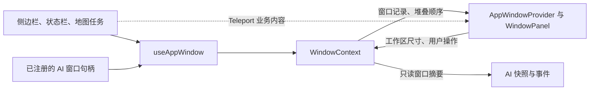

# 地图窗口系统（AppWindow）重构计划

建议把地图容器作为一个窗口工作区，由一个管理器负责窗口的生命周期、堆叠、焦点和几何。业务组件负责表格、表单和地图任务。打开「点位批量操作」后，用户还需要在画布上框选点位。从「物品管理」进入编辑弹窗时，焦点应随操作进入弹窗，并在关闭后回到发起控件。

首个改动建议修复已复现的宽高互换，并为打开、关闭和清理建立测试基线。随后迁移生命周期、几何与输入。首版沿用原地折叠的标题栏，普通关闭后在同一登录会话中记住布局。

## 1. 当前实现与可复现问题

基线为 `b4ac8d14`。首页将窗口宿主、侧边栏、状态栏、地图任务控制器和弹窗宿主挂在同一地图容器。`useAppWindow` 按模块共享一个 `WindowContext`，每次创建业务句柄时生成 UUID。宿主遍历窗口记录画出外框，业务组件通过 `AppWindowTeleporter` 把内容挂到外框提供的节点。侧边栏有 10 个管理窗口和 1 个用户手册，另外还有事件记录、附加图层、点位关联、点位批量操作四个工具窗口。[首页](../../src/HomePage.vue) · [窗口句柄](../../src/components/AppWindow/hooks/useAppWindow.ts) · [窗口宿主](../../src/components/AppWindow/AppWindowProvider.vue) · [管理窗口清单](../../src/components/AppSiderMenu/windowOptions.ts)

以下四例直接运行了仓库的 `WindowContext`。内存环境使用 1440 × 900 的容器，未提供 View Transition API。现有 AI 帮助测试覆盖了窗口句柄的说明与可用状态，这四例应转为窗口管理器自身的 Vitest 回归用例。[WindowContext 源码](../../src/components/AppWindow/core/WindowContext.ts) · [现有帮助测试](../../tests/ai/help.test.ts)

| 操作 | 当前结果 | 重构验收 |
| --- | --- | --- |
| 打开 640 × 360 的窗口，仅更新 `name` | 窗口变为 360 × 640 | 标题更新，位置和宽高逐项相等 |
| 在同一轮调用中打开 A、B，再等待两个 Promise | 两个窗口的 `order` 都是 1，`isTop` 都为真 | 堆叠中各有一个实例，B 在 A 上方 |
| 窗口的 `beforeClose` 返回 `false`，调用 `clearWindow()` | 窗口仍留在列表。登出和宿主卸载都调用这条路径 | 用户关闭可被拒绝，结束会话能释放全部实例 |
| 发起 `openWindow()`，立即 `clearWindow()`，再等待打开完成 | 清理后窗口重新出现在列表 | 已结束会话的打开请求完成后，窗口数仍为零 |

后三例有共同的时序原因。`openWindow` 在异步登记前计算层级，`clearWindow` 只遍历已登记的记录，并逐个请求普通关闭。用户存储触发登出通知后即清除登录态，窗口清理需要在通知当下使旧会话失效。[打开与清理实现](../../src/components/AppWindow/core/WindowContext.ts) · [登出流程](../../src/stores/user.ts)

- **几何有三个来源。** 首次打开读 `params.container` 或 `body`，缩放和纠偏尺寸读 `body`，拖动结束和容器观察器传入地图尺寸，最大化又使用 `100dvw/100dvh`。`cachedInfos` 保存含 DOM 引用和业务回调的整条记录，普通关闭和会话清理共用缓存。[窗口上下文](../../src/components/AppWindow/core/WindowContext.ts) · [拖动逻辑](../../src/components/AppWindow/hooks/useWindowDrag.ts) · [窗口外框](../../src/components/AppWindow/components/WindowPanel.vue)
- **置顶、键盘焦点和指针归属各走各的。** 置顶依赖全局 `pointerdown` 的 DOM 路径。移动与八向缩放各自合并 Pointer 和 Touch 事件流，结束条件只覆盖抬起。标题栏控件使用带点击处理的图标，折叠样式中的 `&.window-content` 匹配同一元素，实际内容是子元素。[拖动逻辑](../../src/components/AppWindow/hooks/useWindowDrag.ts) · [缩放手柄](../../src/components/AppWindow/components/WindowResizer.vue) · [窗口外框](../../src/components/AppWindow/components/WindowPanel.vue)
- **同一个关闭钩子负责决定和善后。** 点位关联在提交期间拒绝关闭，允许关闭时发送 `close$` 来清理任务。批量操作在钩子中释放选择和视口锁，附加图层在钩子中写账号偏好。登出时也得释放任务资源，而偏好写入只应发生在用户主动关闭时。[点位关联](../../src/components/AppStateBar/components/MarkerLink/hooks/useLinkWindow.ts) · [批量操作](../../src/components/MapMarkerTweakController/hooks/useMultiSelect.ts) · [附加图层](../../src/components/AppStateBar/components/SwitchOverlay.vue)

## 2. 工作区、业务和宿主各自拥有什么

Qt 的 `QMdiArea` 是与本项目接近的桌面模型。一个工作区管理多个子窗口，创建顺序、堆叠顺序和激活历史有各自的用途。Win32 也分别定义了窗口的 Z 序、活动窗口和接收键盘输入的控件。这里采用单工作区和显式激活，地图本身也是合法的焦点去向。[Qt QMdiArea](https://doc.qt.io/qt-6/qmdiarea.html#details) · [Microsoft Window Features](https://learn.microsoft.com/en-us/windows/win32/winmsg/window-features#z-order)

| 归属 | 保存的数据与接口 | 生命周期 |
| --- | --- | --- |
| 业务定义和句柄 | 稳定的业务 `key`、权限、标题、初始布局、允许的操作、所属组件。管理窗口复用 `windowOptions.ts` | 一个所有者持有一个实例 `id`，同一句柄关闭再打开沿用该 id。AI 使用 `window.<key>` 寻址 |
| 工作区管理器 | 按 id 索引的窗口记录、从底到顶且无重复的 `stack`、可为空的 `activeId`、当前会话内的布局缓存 | 每个 Vue 应用创建一次。登出重置会话，所有者卸载只处置所属窗口 |
| Vue 宿主和外框 | 容器测量、Teleport 挂点、焦点元素、指针捕获、动画和监听器 | DOM 挂载时登记，卸载时释放。业务表单状态留在原组件树 |

在 `main.ts` 挂载前创建管理器并用 `app.provide` 注入。侧栏与 `AppWindowProvider` 是兄弟组件，都从共同祖先取得实例。无参数的 `useAppWindow()` 在组件内取得上下文，有参数的版本保留响应式 `info/isOpen`、`open(): Promise<void>` 和现有 `close()/toggle()` 用法。动态安装 AI 桥接时显式传入只读窗口摘要接口，供组件 setup 之外的快照与监听使用。管理器的状态转换只接收数据，DOM 测量、动画和焦点操作由宿主执行。[启动入口](../../src/main.ts) · [现有类型契约](../../src/components/AppWindow/types/index.d.ts) · [桥接安装](../../src/ai/install.ts)

保留 Teleport 的逻辑父子关系，管理页仍按需加载，点位关联仍接收原组件的 `v-model` 和事件。外框用实例 id 注册内容挂点，挂点就绪后再传送插槽。折叠保留已挂载的表单和 iframe，关闭实例才卸载内容。[业务 Teleporter](../../src/components/AppWindow/components/WindowTeleporter.vue) · [Vue Teleport](https://vuejs.org/guide/built-ins/teleport.html#using-with-components)

## 3. 生命周期与关闭契约

Qt 将关闭表达为业务可接受或拒绝的请求。项目还需要处理账号、权限或组件所有权终止。建议在管理器内区分 `requestClose` 和 `dispose`，前者询问业务，后者收回指定范围的前端资源。两条路径共用一次性的关闭收尾。[Qt QCloseEvent](https://doc.qt.io/qt-6/qcloseevent.html#details)

| 操作 | 应有行为 |
| --- | --- |
| 打开 | 在首次等待前登记正在打开的 id。相同 id 的并发请求共享结果，`beforeOpen` 每次打开只运行一次。不同 id 按请求顺序占据唯一栈位。`await open()` 成功时，状态可回读且内容挂点可用，异步管理页可继续加载 |
| 再次打开 | 管理器的 `open` 保证实例存在。系统管理网格的显式点击额外执行展开和激活，保留原内容。用户手册与事件记录入口沿用显式 `toggle`。由偏好或地图任务触发的打开可保留画布焦点 |
| 请求关闭 | 关闭按钮、业务取消和 AI 句柄请求同一操作。守卫拒绝后保留窗口和任务。允许后移出堆叠，发布一次 `onClosed(reason)`，重复关闭按已关闭处理。旧的同步守卫按原约定适配 |
| 竞争与失败 | 打开中收到关闭时取消该次打开，收尾中的同一 id 再次打开时等上次收尾完成。为每次打开和每个会话分配标识，迟到的挂载、确认或动画回调只对原实例生效。打开守卫拒绝、抛错或挂点创建失败时结清等待并释放预留栈位。关闭守卫抛错时保留原窗口 |
| 处置 | 登出在第一个异步等待前使整次会话失效。权限撤销或所有者卸载只使相关实例失效。终止手势，执行一次业务清理，清除相应的挂点、布局缓存和订阅。某个清理回调抛错时继续释放其余窗口 |

`open` 可能早于宿主首次挂载，附加图层的即时偏好监听就是一例。把这类请求保留到工作区首次取得有效尺寸，宿主卸载或会话结束时结清等待者。视图过渡只装饰已确定的状态变化，浏览器支持、缺失、中止过渡及启用 `prefers-reduced-motion` 四种情况下的打开结果一致。[附加图层入口](../../src/components/AppStateBar/components/SwitchOverlay.vue) · [现有过渡样式](../../src/style/transition/views/windows.scss)

## 4. 显示状态、几何与输入

**几何。** Win32 的 `WINDOWPLACEMENT` 单独保存还原矩形和显示状态，并明确区分工作区坐标与屏幕坐标。地图窗口统一使用宿主内容区的 CSS 像素，左上角为原点。打开、拖动、八向缩放、最大化和恢复调用同一组几何函数。指针坐标由宿主按容器位置换算，地图世界坐标仅由地图处理。[Microsoft WINDOWPLACEMENT](https://learn.microsoft.com/en-us/windows/win32/api/winuser/ns-winuser-windowplacement)

- `normalRect` 记录用户上次在常规状态提交的位置与大小。展开方式为常规或最大化，另外记录是否折叠。最大化填满地图宿主，折叠只显示可操作的标题栏。最大化 → 折叠 → 展开回到最大化，再还原得到之前的常规矩形。移动折叠标题栏只更新其折叠位置。[Qt 子窗口的标题栏折叠](https://doc.qt.io/qt-6/qmdisubwindow.html#showShaded)
- 首次打开沿用各入口的居中或靠边规则。管理窗口和手册首次最大化，默认还原尺寸按现有 887 × 500 起算。将初始偏好、最小约束和用户已经调整的矩形分开，改标题或更新 `computed` 配置只影响对应字段。[侧栏窗口参数](../../src/components/AppSiderMenu/AppSiderMenu.vue) · [事件记录窗口](../../src/components/AppStateBar/components/WebSocketStatus/WebSocketStatus.vue)
- 地图宿主的 `ResizeObserver` 提供有效边界。最小尺寸取业务下限与可用尺寸的较小者，先约束宽高，再约束位置。向左或向上缩放时固定对边。容器临时缩小只调整显示矩形，恢复空间时可回到 `normalRect`。零尺寸时保留最后有效布局。普通关闭只缓存几何和展开方式，按当前会话及所有者回收。

**指针。** 可拖动的标题区域和八个手柄共用同一套 Pointer Events 处理。主指针以主键按下时记录起始矩形和边缘，调用 `setPointerCapture(pointerId)`，随后只接收该指针。`pointerup` 提交最后一帧，`pointercancel`、意外 `lostpointercapture`、页面失焦、模态弹窗出现或卸载则取消并回到已提交矩形。抬起后正常触发的 `lostpointercapture` 走幂等收尾。`touch-action: none` 只用于拖动部位，内容保留文本选择、滚动和业务拖放，工作区空白继续将指针交给地图。[W3C Pointer Events](https://www.w3.org/TR/pointerevents3/#pointer-capture)

拖动期间每帧最多更新活动窗口一次，从起始矩形和指针偏移计算预览。只在结束时提交布局缓存。最大化窗口只接受还原等标题栏命令。键盘和单指点击都能从窗口菜单选择「移动」「调整大小」，通过方向按钮或方向键微调、确认或取消，复用相同的几何约束。这也给触屏用户提供了拖动之外的完整操作路径。[WCAG 2.2 单指拖动替代方式](https://www.w3.org/WAI/WCAG22/Understanding/dragging-movements.html)

**激活与模态。** 点击窗口或焦点进入其内容时将该实例移到栈顶，栈序派生出 `order`。工作区最多一个活动窗口，点回画布时 `activeId` 可以为空。指针点输入框时保留浏览器放置光标的行为。显式打开管理页时聚焦其上次可用控件或标题。关闭活动窗口后优先恢复可用的发起控件，再选最近活动的可见窗口，最后回到地图。关闭后台窗口保留当前焦点。

- 管理窗口使用具名的非模态 `role="dialog"`，以 `aria-labelledby` 关联可见标题。标题栏操作使用有名称的原生按钮和可见焦点环，Tab 可在窗口、其他工具和地图之间移动。折叠时，若焦点在内容区，先移到展开按钮，再隐藏内容并使其退出 Tab 序列和无障碍树。功能网格入口也需支持键盘激活。[窗口外框](../../src/components/AppWindow/components/WindowPanel.vue) · [系统管理网格](../../src/components/AppSiderMenu/components/FeatureGrid/FeatureGrid.vue)
- 现有状态栏层级为 9，侧栏和窗口宿主均为 10。由首页确定画布、常驻控件、非模态窗口、应用模态的层次，窗口层内部按 `stack` 排序。下拉菜单优先挂到所属窗口外框内、滚动内容外的节点。必须传送至 `body` 的浮层显式记录所属窗口，处理命中、焦点和失活时的关闭。切换窗口后，前一个窗口的菜单也应让出前景。[状态栏](../../src/components/AppStateBar/AppStateBar.vue) · [侧栏](../../src/components/AppSiderMenu/components/SiderMenu/SiderMenu.vue) · [现有浮层迁移方案](../element-plus-to-reka-ui-migration-proposal.md)
- 登录弹窗、全局弹窗和使用 `showModal()` 的公告都优先接收输入。全局弹窗由 `GlobalDialogService` 的队列与 `afterClosed` 驱动，原生公告由浏览器顶层承载。模态期间暂停背景窗口激活和地图快捷键，焦点在模态内循环。队列交接时由下一个弹窗接管焦点，最后一个关闭后才恢复发起控件。Esc 先交给当前下拉、模态或正在进行的窗口操作，由其既有关闭策略处理。[全局弹窗队列](../../src/components/AppDialog/context.ts) · [公告宿主](../../src/components/AppNotice/context.ts) · [WAI-ARIA 模态对话框](https://www.w3.org/WAI/ARIA/apg/patterns/dialog-modal/) · [HTML 模态对话框](https://html.spec.whatwg.org/multipage/interactive-elements.html#dom-dialog-showmodal)

## 5. 业务入口与 AI 兼容

| 入口 | 迁移时要验证的行为 |
| --- | --- |
| 10 个管理窗口和用户手册 | 菜单和 AI 共用 `windowOptions.ts` 的权限及业务 key。当前模板用权限控制 Teleport 内容，撤权后外框可能仍在。打开和异步提交前复核权限，撤权时处置对应实例。手册 iframe 在折叠、置顶后保持同一实例，跨过 iframe 拖动标题栏也能结束手势。[侧栏注册](../../src/components/AppSiderMenu/AppSiderMenu.vue) · [手册 iframe](../../src/pages/document/PageDocument.vue) |
| 事件记录、附加图层 | 保留状态栏入口和首次靠边位置，用户手动摆放后以其位置为准。附加图层跟随 `map.state.showOverlay`，用户主动关闭才回写该偏好。账号切换按新账号的偏好打开，系统处置只清理旧界面。[事件记录](../../src/components/AppStateBar/components/WebSocketStatus/WebSocketStatus.vue) · [附加图层](../../src/components/AppStateBar/components/SwitchOverlay.vue) |
| 点位关联 | 提交中的 `loading` 是用户关闭守卫。已关闭回调统一驱动 `close$ → clearMission → end$`，恢复点位焦点策略并清理临时修改。提交成功、用户取消、登出各自只收尾一次，晚到的请求结果归属原会话。[关联窗口钩子](../../src/components/AppStateBar/components/MarkerLink/hooks/useLinkWindow.ts) · [关联任务](../../src/components/AppStateBar/components/PaintMarkerLink.vue) |
| 点位批量操作 | 从画布快捷键开窗后仍可框选。地图快捷键按画布焦点、编辑目标和 `defaultPrevented` 过滤，在窗口输入框打字时只编辑表单。`finalizeMission` 对关闭和卸载幂等，释放选择、临时点位、光标及视口锁。[框选任务](../../src/components/MapMarkerTweakController/hooks/useMultiSelect.ts) · [快捷键来源](../../src/stores/shortcut.ts) |

桥接按协议 `1.0.0` 验收。11 个 `window.<key>` 继续表示业务能力，`app.snapshot` 的 `ui.windows[].id` 继续表示运行实例。`ui.surfaces.list/get/open/close` 在协议中均为 `read`，打开仍检查角色，无权限返回 `E_FORBIDDEN`。现有四个工具窗口通过窗口快照可见，句柄清单沿用侧栏注册范围。[桥接文档](../ai-bridge.md) · [UI 命令](../../src/ai/commands/ui.ts)

- `open` 等待窗口提交后再读状态，保留 `{ id, opened, queued, sinceSeq }`。普通窗口直接打开，`queued` 继续描述全局弹窗队列。当前 `ui.surfaces.close` 调用能力后直接报告成功。窗口句柄应返回 `requestClose` 的结果供命令等待。目标已关闭时按幂等成功回应，守卫拒绝时返回 `{ id, closed: false }`。`surface:close` 对应成功的命令，业务 `onClosed` 对应实际发生的关闭。
- 快照保留 `id/name/sizeState/interactionState/order/size/translate` 的字段约定与可选性。`default/maximize/minimize` 和 `default/manual` 由适配层映射，`size/translate` 沿用原有常规布局口径。`includeWindowStates: false` 时 `windows` 为空数组。`window:change` 继续按排序后的窗口名称列表发出 `{ names }`，拖动逐帧产生的预览留在宿主。[快照实现](../../src/ai/appSnapshot.ts) · [窗口事件监听](../../src/ai/install.ts)

## 6. 实施顺序与回退

| 阶段 | 可独立评审的改动 | 进入下一阶段的条件 |
| --- | --- | --- |
| 1 · 基线与局部修复 | 在 `tests/components/AppWindow/` 建立独立上下文，修复 `updateWindow` 宽高互换。记录现有重复打开、同步守卫、管理窗口快照与事件样本 | 改标题回归通过，样本能区分业务 key 和实例 id |
| 2 · 拆开关闭判断与业务清理 | 在现有入口引入 `dispose(reason)` 和带原因的关闭通知。迁移点位关联、批量操作、附加图层的副作用，再将登出和卸载接到处置路径 | 对已打开窗口模拟提交中关闭、登出、卸载和成功回调交错，任务只清理一次，账号偏好只随用户操作写入 |
| 3 · 切换工作区管理器 | 在 `AppWindow/core` 落地堆叠、同步预留、取消及会话管理。一次切换应用注入、Provider、兼容 hook 和 AI 摘要读取，保留既有 Teleporter 接口 | 第 1 节四例全部通过。侧栏、状态栏及桥接观察到同一组实例，11 个句柄逐项通过角色测试 |
| 4 · 统一几何与指针 | 接入容器测量、显示矩形和 Pointer Events，替换两套拖动流。先用事件记录验证靠边和自由摆放，再覆盖最大化管理页、折叠和任务窗口 | 八向缩放、触控取消、窗口跨 iframe 拖动、非全屏地图以及动画降级通过验收 |
| 5 · 完成焦点与浮层迁移 | 标题栏和网格键盘操作、可点击的移动缩放、窗口菜单归属、模态交接及权限变化。窗口相关桥接语义同步到 `tests/ai/`、`docs/ai-bridge.md` 与 `AGENTS.md` | 完成下面的浏览器工作流，再移除旧全局订阅、模块单例及整条窗口记录缓存的残余代码 |

每个构建只装配一个窗口管理器和一套输入监听。若切换后出现窗口在登出后重现、地图视口锁未释放或桥接与界面状态相异，停止推广，回退对应阶段及依赖它的接线提交。第一阶段的回归用例可继续运行。布局在会话内保存，回退后用户账号存档仍按既有格式读取。

## 7. 实施验收

| 验证位置 | 场景与可观察结果 |
| --- | --- |
| Vitest 纯逻辑 | 同 id 并发只执行一次打开守卫，异 id 并发只有一个栈顶。覆盖拒绝、异常、打开时清理、关闭时重开，以及旧回调晚到。正常 → 最大化 → 折叠 → 展开 → 还原得到原矩形 |
| 几何与组件 | body 为 1440 × 900、地图容器位于 (100, 60) 且大小为 640 × 360 时，最大化矩形是局部的 (0, 0, 640, 360)。左、上或角手柄到达下限时对边固定。标题、放置偏好和用户调整分别更新。双指交错、抬起后丢捕获、卸载都至多提交一次 |
| 宿主资源与事件 | 重复挂载和卸载工作区，窗口挂点、监听器和观察器数量回到挂载前基线。用浏览器性能面板记录一次连续拖动，每帧至多更新当前操作的窗口一次，期间 `window:change` 新增事件数为零 |
| 桥接契约 | 将 11 个句柄逐个走 `list → open → get → snapshot → close`。核对允许及拒绝角色、`opened` 即时回读、`names` 事件和处置后的空列表。`?aiBridge=read` 下窗口导航按 R 级执行，写命令仍返回 `E_FORBIDDEN`。以默认配置打开生产预览，确认 `window.__MAP_AI__` 与 `data-ai-bridge` 均未设置 |
| 桌面浏览器 | 打开两个管理窗口，从网格激活已有窗口。物品管理 → 编辑弹窗 → 关闭，焦点回到发起控件。覆盖弹窗排队、公告打开和登出转登录。检查 Tab、Shift+Tab、Esc、焦点环，以及折叠后的内容是否退出 Tab 序列 |
| 地图与触屏 | 在点位批量操作窗口旁进行框选，拖窗口时画布视口保持原值，松手后画布可继续平移。触屏上只靠点按完成移动和缩放。用模拟提交状态验证关联窗口拒绝普通关闭，随后的系统处置能释放任务和焦点 |

纯逻辑与组件场景纳入现有 `unit` project，桥接契约放入 `tests/ai/`。真实指针捕获、iframe、浏览器顶层与焦点顺序在运行中的页面验证。各实现阶段使用 `pnpm typecheck`、`pnpm test:run --project unit`、`pnpm lint`、`pnpm build` 和仅针对改动源码的 `pnpm exec oxfmt --check`。[仓库验证约定](../../AGENTS.md) · [Vitest 项目配置](../../vitest.config.ts)
